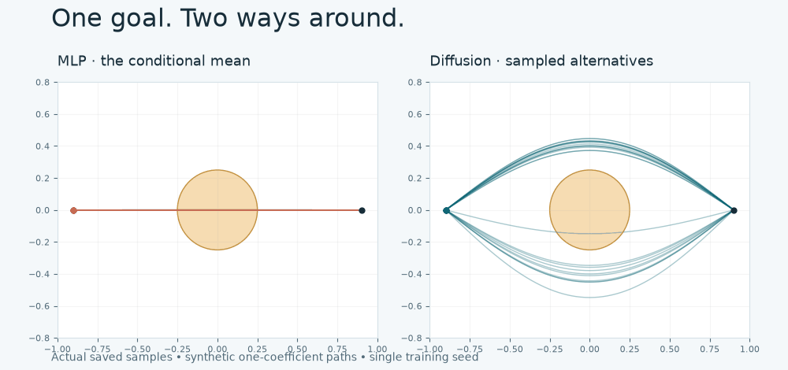

# Trajectory Playground

**One goal. Two ways around. Why averaging good paths can produce a bad one.**

[**Open the interactive demo →**](https://rwlinno.github.io/trajectory-playground/) · [中文说明](README.zh-CN.md) · [Experiment results](artifacts/evaluation.json)



A tiny, reproducible lesson in multimodal generation. A squared-error MLP and a conditional diffusion model see the same symmetric demonstrations. The MLP learns the mean; diffusion samples alternatives. Explore nine saved scenes, resample paths, replay motion, and see which paths actually avoid the obstacle.

**This is a teaching project, not a robot planner or a state-of-the-art benchmark.** The model learns one coefficient in a deliberately restricted sine-path family. A simple two-component mixture or randomized geometric planner could solve this example too.

## Try it

The [live demo](https://rwlinno.github.io/trajectory-playground/) needs no installation, GPU, account, or backend. Everything is served as static files. It displays real pre-generated model outputs, not live neural inference. Each scene contains 64 unfiltered samples per method. Resample shuffles the bank; all 64 paths form the same set.

Locally, with Python 3:

```bash
python3 -m http.server 8000 --directory docs
# Open http://localhost:8000
```

## Reproduce

Python 3.11 is the tested version. CPU training is sufficient. The pinned environment used for the committed run is in `requirements.txt`; installations on other platforms can differ.

```bash
uv venv --python 3.11
uv pip install --python .venv/bin/python -r requirements.txt
.venv/bin/python -m unittest discover -s tests -v
.venv/bin/python scripts/verify_artifacts.py
```

To retrain and replace the checked-in weights, evaluation and demo samples:

```bash
bash scripts/run_demo_training.sh
.venv/bin/python scripts/verify_artifacts.py
.venv/bin/python scripts/render_preview.py
node --test tests/web.test.js
```

Without `uv`, create a standard Python virtual environment and install with `pip install -r requirements.txt`. Node.js 22+ is needed only for the JavaScript tests; the website has no build step or npm dependencies.

## The experiment

For t ∈ [0,1], paths are

```
x(t) = -0.9 + 1.8t
y(t) = slope · x(t) + a · sin(πt)
```

Both networks condition on the circle radius, its horizontal position, and the endpoint slope. The scalar `a` chooses how far and on which side the path bends. The circle center lies on the straight start-to-goal line. Units are normalized coordinates, not meters.

- **Data:** 4,096 sampled conditions, two symmetric demonstrations per condition, 8,192 training examples. Radius ∈ [0.16,0.32], horizontal position ∈ [-0.18,0.18], slope ∈ [-0.2,0.2].
- **MLP:** squared-error coefficient regression. Both members of a demonstration pair appear in every training batch. Under this intentionally symmetric distribution, the optimal conditional mean is zero.
- **Diffusion:** coefficient-space DDPM with a 64-step cosine schedule and a small noise-prediction MLP. Training uses float32; saved-sample inference uses float64 to reduce CPU-dependent numerical drift. No rejection sampling, obstacle projection or sample filtering.
- **Evaluation:** 128 independently drawn, in-distribution conditions, 64 samples each, distinct training and evaluation random streams. The nine UI presets are additional cases, not the evaluation set.
- **Validity:** every segment avoids the circle and the whole polyline stays within [-1,1]². This treats the moving object as a point. Endpoints are guaranteed by the path parameterization, not learned.
- **Valid routes:** the number of sides (above/below) represented by at least one valid sample, from zero to two. It is a coarse coverage statistic, not a calibrated distribution metric.

Committed single-seed run (training seed 42):

| Method | Valid paths ↑ | Collision rate ↓ | Mean valid routes / 2 ↑ |
|---|---:|---:|---:|
| MLP regression | 0.00% | 100.00% | 0.00 |
| Conditional diffusion | 98.33% | 1.67% | 2.00 |
| Synthetic reference generator | 100.00% | 0.00% | 2.00 |

These figures describe **this constructed teaching example only**. There are no multi-seed confidence intervals, arbitrary obstacle maps, physics, learned IK, joint limits, or real-robot claims. A generative model is not intrinsically required to solve it. Paths that collide remain in the sample bank and the metrics.

## Inspect the evidence

| File | Contents |
|---|---|
| `src/experiment.py` | Data generator, both networks, training, sampling, geometry, evaluation |
| `artifacts/models.pt` | Trained state dictionaries and training settings |
| `artifacts/evaluation.json` | Per-condition metrics, summary, training trace, versions and SHA-256 provenance |
| `docs/assets/samples.json` | Nine full sample banks used by the browser |
| `scripts/verify_artifacts.py` | Checks hashes and regenerates every bank and held-out metric from saved weights |
| `tests/test_geometry.py` | Collision, endpoint, mode coverage and reference-validity tests |
| `tests/web.test.js` | Segment collision and JavaScript/Python metric agreement on all published presets |

The browser reconstructs paths from rounded coefficients; its metric agreement test allows 1e-5 path-length error. Replay verification allows 2e-5 coefficient error and 1e-4 continuous-geometry error across CPU kernels; per-condition collision rates, valid rates and coverage must match exactly. Exact training reproduction can vary with PyTorch/platform versions.

## Ideas to explore

Change the balance between the two modes. Compare with a mixture density network. Add a second obstacle and observe the limits of the sine basis. Measure valid coverage at a fixed sampling budget. Report failures instead of hiding them.

## Background and provenance

This repository is a fresh, minimal teaching implementation, extracted conceptually from an unfinished trajectory-generation prototype. It does not reuse that prototype's unverified result tables or claim to reproduce a robotics paper.

- [Denoising Diffusion Probabilistic Models](https://arxiv.org/abs/2006.11239), Ho et al., 2020 — noise-prediction objective and sampling.
- [Improved Denoising Diffusion Probabilistic Models](https://arxiv.org/abs/2102.09672), Nichol & Dhariwal, 2021 — cosine noise schedule.
- [Diffusion Policy](https://diffusion-policy.cs.columbia.edu/), Chi et al., 2023 — a substantially richer robotics setting; this demo is **not** a reproduction.

MIT licensed. Code, synthetic samples, trained weights and visual assets in this repository are released under the same license. Contributions that keep the example small, correct, and easy to understand are welcome.


## Research context and diagnostics · 2026-10-14

[中文研究评估与低成本路线](RESEARCH_REPORT.zh-CN.md) covers verified evidence, diffusion / flow-matching / VLA context, practical next steps, and stopping criteria. The live report now includes distribution diagnostics; research references are context, not implemented baselines.
